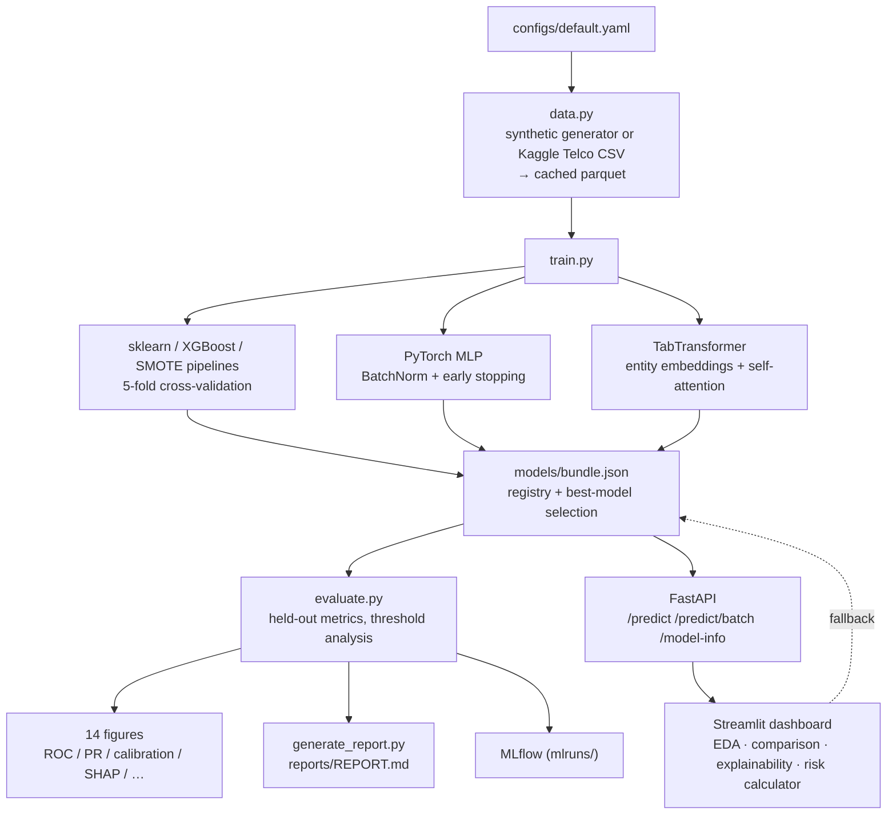

# 📉 Customer Churn Prediction — Production-Grade ML System

[](https://www.python.org/)
[](https://pytorch.org/)
[](https://scikit-learn.org/)
[](https://github.com/skm-edu4/Customer-Churn-Prediction/actions/workflows/ci.yml)
[](LICENSE)

> **Seven models, one pipeline, zero leakage** — a structured ML system that compares classical ML (LogReg, Random Forest, Gradient Boosting), XGBoost, an imbalanced-learn SMOTE variant, and two from-scratch PyTorch models (MLP + TabTransformer), then evaluates, explains and serves the winner behind a FastAPI endpoint and a Streamlit dashboard.

---

## 🧩 Problem → Process → Outcome

**The problem.**
Subscription businesses lose 30–40% of their customers every year, but retention
teams usually find out *after* the cancellation. Support and ops teams had no way
to get a **calibrated, explainable churn risk score** per customer — and naive
accuracy scores actively mislead on imbalanced data (a model that never predicts
"churn" still scores ~64% accuracy here).

**The process.**
A production-style ML system rather than a notebook:

1. **Data** — a deterministic synthetic dataset (seed-reproducible, ground truth
   known) with a drop-in path for the Kaggle *Telco Customer Churn* CSV.
2. **Leakage-free comparison** — 7 model families under one 5-fold CV harness:
   Logistic Regression, Random Forest, Gradient Boosting, XGBoost, an
   imbalanced-learn **SMOTE** pipeline (resampling inside the fold), a PyTorch
   **MLP**, and a from-scratch **TabTransformer** (entity embeddings +
   self-attention).
3. **Honest evaluation** — ROC-AUC, PR-AUC, F1, **calibration (ECE)**, threshold
   trade-off analysis, learning curves, and a single untouched test set.
4. **Explanation** — SHAP (TreeExplainer + DeepExplainer) and model-agnostic
   permutation importance.
5. **Delivery** — best model behind a **FastAPI** REST contract, an interactive
   **Streamlit** dashboard, MLflow experiment tracking, a Markdown report, 34
   tests and GitHub Actions CI.

**The outcome.**
- Best model **Logistic Regression: test ROC-AUC 0.781, PR-AUC 0.658**
  (vs. 0.36 base rate → ~1.8× lift); all 7 models within 5 AUC points —
  measured evidence that well-tuned linear/tree models rival deep nets on
  tabular data.
- **Best-calibrated** model is the PyTorch MLP (ECE 0.049); the from-scratch
  TabTransformer is the strongest deep model (ROC-AUC 0.776).
- Explicit business levers: threshold **0.3 catches 90.6%** of churners
  (673 flags), threshold **0.5 balances at 56% precision / 71% recall** —
  retention spend vs. missed churners becomes a one-line decision.
- Feature insight: `contract_type` alone explains **−0.18 ROC-AUC** when
  shuffled, while `total_charges` and `payment_method` are dead weight.
- Fully reproducible: `make setup && make pipeline` in minutes, no API keys,
  no downloads.

## 🎯 What this project does

1. **Trains** 7 model families on a 5,000-row churn dataset (synthetic by default, drop-in compatible with the Kaggle Telco dataset)
2. **Compares** them with 5-fold cross-validation and a held-out test set
3. **Explains** predictions with SHAP (TreeExplainer + DeepExplainer) and model-agnostic permutation importance
4. **Visualises** everything with 14 matplotlib/seaborn figures (ROC, PR, calibration, thresholds, learning curves, clusters…)
5. **Tracks** experiments in MLflow and emits a Markdown evaluation report
6. **Serves** the best model over REST (FastAPI) and a live risk calculator (Streamlit)
7. **Guarantees** quality with 34 tests (unit + end-to-end) and GitHub Actions CI

## 🏗️ Architecture



## 📊 Results (seed 42, 5,000 rows, 36.1% churn rate)

**Held-out test set (1,000 rows):**

| Model | ROC-AUC | PR-AUC | F1 | ECE ↓ |
|---|---|---|---|---|
| **logistic_regression** ✅ | **0.781** | **0.658** | **0.627** | 0.097 |
| tabtransformer (PyTorch) | 0.776 | 0.655 | 0.562 | 0.054 |
| gradient_boosting_smote | 0.775 | 0.653 | 0.611 | 0.067 |
| torch_mlp (PyTorch) | 0.773 | 0.648 | 0.555 | 0.049 |
| gradient_boosting | 0.772 | 0.647 | 0.534 | 0.047 |
| xgboost | 0.741 | 0.607 | 0.542 | 0.080 |
| random_forest | 0.730 | 0.586 | 0.559 | 0.087 |

**Honest takeaways worth discussing in an interview:**

- The synthetic data's ground-truth mechanism *is* a logistic model — so the linear model wins, and the deep models land within **0.5 ROC-AUC points** of it. On tabular data, neural networks rarely beat well-tuned linear/tree models; this repo shows that empirically instead of asserting it.
- The **from-scratch TabTransformer** (entity embeddings + transformer encoder, no pretrained libraries) is the second-best model and the **best-calibrated deep model** (ECE 0.054).
- **Accuracy is the wrong metric here**: at threshold 0.5 the recall/precision trade-off is very different from 0.3 — see the threshold analysis in `reports/REPORT.md`.
- Permutation importance says `contract_type` alone accounts for **−0.18 ROC-AUC** when shuffled; `total_charges` and `payment_method` add nothing once other features are known (correlation, not causation).

## 📸 Screenshots

### 1. Executing the pipeline

**`make train`** — 5-fold CV across all candidates, torch training, model selection:


**`make evaluate`** — held-out test metrics + permutation importance + 14 figures:


### 2. Serving the model (FastAPI)

**`curl` against the live API** — health, model info, and two opposite risk profiles:


**Interactive Swagger docs at `/docs`** — typed schemas, 422 validation, batch endpoint:


### 3. Streamlit dashboard

**Overview** — dataset, best model, live ROC-AUC:


**Model comparison** — all 7 models, ROC/PR/calibration side by side:


**Risk calculator** — score a customer through the API and get a risk band:


### 4. Evaluation & explainability figures

| Figure | |
|---|---|
| EDA overview |  |
| ROC curves (all models) |  |
| Calibration |  |
| Confusion matrix (best model) |  |
| Threshold trade-off |  |
| TabTransformer training curves |  |
| Learning curve (bias–variance) |  |
| Permutation importance |  |
| SHAP — tree model |  |
| SHAP — PyTorch MLP (DeepExplainer) |  |

> All screenshots were captured from the actual run (seed 42). Regenerate everything with `make pipeline`.

## 🧠 Skills & libraries map

| Area | Where |
|---|---|
| **PyTorch** | `src/churn/training/` — custom `nn.Module`s, Dataset/DataLoader, AdamW + cosine LR, early stopping, checkpointing, weighted BCE & focal loss |
| **scikit-learn** | `training/baselines.py` — pipelines, `ColumnTransformer`, `GridSearchCV`-style CV, learning curves, permutation importance |
| **XGBoost** | `training/baselines.py` — tuned `XGBClassifier` in the same CV harness |
| **imbalanced-learn** | `gradient_boosting_smote` — SMOTE *inside* the CV fold (no leakage) |
| **matplotlib / seaborn** | `evaluation/plots.py` — 14 publication-style figures |
| **SHAP** | `explain/shap_analysis.py` — TreeExplainer + DeepExplainer + permutation fallback |
| **MLflow** | `tracking.py` — params/metrics/artifacts to a local file store |
| **FastAPI / pydantic** | `serving/` — typed request contract, validation, 422s, batch endpoint, OpenAPI docs |
| **Streamlit** | `dashboard/app.py` — EDA, model comparison, explainability, live scoring |
| **Testing / CI** | `tests/` (34 tests incl. end-to-end), ruff, mypy, GitHub Actions matrix 3.11/3.12 |
| **Packaging** | `pyproject.toml` + uv, src layout, Makefile, typed config (pydantic + YAML) |

## 📁 Project structure

```
Customer-Churn-Prediction/
├── configs/default.yaml          # every knob: seed, model hparams, thresholds
├── src/churn/
│   ├── config.py                 # pydantic config loader
│   ├── data.py                   # synthetic generator + Telco CSV loader + parquet cache
│   ├── features.py               # shared ColumnTransformer + TorchFeatureEncoder
│   ├── models_io.py              # uniform Predictor interface for all 7 models
│   ├── tracking.py               # MLflow wrapper (best-effort, never breaks training)
│   ├── training/
│   │   ├── baselines.py          # LogReg / RF / GBM / XGBoost / SMOTE pipeline
│   │   ├── torch_common.py       # Trainer: early stopping, cosine LR, checkpoints
│   │   ├── torch_mlp.py          # ChurnMLP (BatchNorm + dropout)
│   │   └── tab_transformer.py    # TabTransformer (embeddings + self-attention)
│   ├── evaluation/               # metrics (ROC/PR/ECE/thresholds) + plots
│   ├── explain/shap_analysis.py  # SHAP + permutation importance
│   └── serving/                  # FastAPI app + pydantic schemas
├── scripts/                      # train.py · evaluate.py · generate_report.py
├── dashboard/app.py              # Streamlit
├── tests/                        # 34 tests incl. end-to-end pipeline test
├── .github/workflows/ci.yml      # ruff → mypy → pytest on 3.11 & 3.12
├── Makefile
└── reports/                      # generated: figures + REPORT.md
```

## 🚀 Getting started

Requires [uv](https://docs.astral.sh/uv/) (or plain pip).

```bash
git clone https://github.com/skm-edu4/Customer-Churn-Prediction.git
cd Customer-Churn-Prediction

make setup                 # uv sync — creates .venv, installs everything

make pipeline              # train → evaluate → report  (models/, reports/)
make serve                 # FastAPI  → http://localhost:8000/docs
make dashboard             # Streamlit → http://localhost:8501
```

No API keys, no downloads — the dataset is generated deterministically from `seed`.

<details>
<summary>pip alternative (no uv)</summary>

```bash
python -m venv .venv && source .venv/bin/activate
pip install -e .
pip install pytest ruff mypy httpx types-PyYAML pandas-stubs   # dev tools
python scripts/train.py && python scripts/evaluate.py && python scripts/generate_report.py
```
</details>

### Use the real Telco dataset

```bash
# from https://www.kaggle.com/datasets/blastchar/telco-customer-churn
mv telco.csv data/raw/telco_customer_churn.csv
# set `data.source: telco` in configs/default.yaml
make pipeline
```

### Everyday commands

| Command | What it does |
|---|---|
| `make train` | CV + fit all 7 models, select best, write `models/bundle.json` |
| `make evaluate` | Held-out metrics + 14 figures + SHAP |
| `make report` | Build `reports/REPORT.md` |
| `make test` | pytest (unit + end-to-end) |
| `make lint typecheck` | ruff + mypy |
| `make clean` | Remove generated artefacts |

## 🛡️ Design decisions (the interview-defence bits)

**Why a `bundle.json` + one `Predictor` interface?**
Seven models with three different loading mechanisms (joblib pipeline, torch + preprocessor, torch + encoder) are useless to a serving layer that must load "the best one". `models_io.py` normalises all of them behind `predict_proba(DataFrame)` — the API and dashboard don't know (or care) what's inside.

**Why is preprocessing inside the pipeline?**
Every sklearn candidate wraps imputation/scaling/one-hot in the `Pipeline`, so CV folds never see statistics from validation rows. The torch models use a sub-split of the training set for early stopping, and encoders are fit on the sub-train fold only.

**Why SMOTE inside an `imblearn.Pipeline`?**
Resampling before the split would leak synthetic points across folds. imblearn's pipeline applies SMOTE only to training folds.

**Why report ECE (calibration) and PR-AUC?**
Churn is imbalanced (36%) and the output is used as a *risk score*, not just a label — a confidently-wrong 0.9 costs more than an uncertain 0.5. Accuracy alone hides both problems.

**Why a from-scratch TabTransformer instead of `torchtabular`?**
To be able to explain every parameter: entity-embedding tables sized from the data, a `[CLS]` token, positional embeddings, `TransformerEncoder` blocks, then a continuous-feature head.

**The macOS dual-libomp workaround (read this if you port the repo):**
`xgboost` links `@rpath/libomp.dylib` while PyTorch bundles its *own* `libomp.dylib`. In one process, two OpenMP runtimes deadlock (or segfault) inside their barriers. `churn/__init__.py` pins `OMP_NUM_THREADS=1` before either library loads — negligible cost at this data size, and the reason the pipeline is stable on macOS. See the comment there for details.

**Why did the linear model win?**
See the honest results discussion above — and be ready for the follow-up: *"what would you do with real data?"* → richer features (usage aggregates, support-sentiment), time-aware splits, and calibration-first threshold selection per business cost.

## ✅ Testing & CI

```bash
make test        # 34 tests, ~1 min
```

- `test_data.py` — generator determinism, schema, parquet caching
- `test_features.py` — leakage-free transforms, unseen-category handling, picklability
- `test_metrics.py` — ROC/PR/ECE math, threshold monotonicity
- `test_torch_model.py` — forward shapes, learning a separable pattern, seeded determinism, focal loss
- `test_api.py` — FastAPI contract: health, model-info, 422 validation, batch, 503 without a model
- `test_pipeline_integration.py` — runs `train.py` → `evaluate.py` → `generate_report.py` end-to-end in a temp dir

CI (`.github/workflows/ci.yml`) runs ruff → ruff-format → mypy → pytest on **Python 3.11 and 3.12**.

## 🔮 Roadmap

- [ ] Time-based split (churn is a temporal event, not i.i.d.)
- [ ] Optuna hyperparameter search replacing the manual grids
- [ ] ONNX export for the torch models + latency benchmark
- [ ] Dockerfile + docker-compose for API + dashboard
- [ ] DVC for dataset/versioned experiments
- [ ] Cost-sensitive thresholding (explicit false-positive / false-negative prices)

## 📄 License

MIT — see [LICENSE](LICENSE).

## 🙏 Acknowledgments

Built with [scikit-learn](https://scikit-learn.org/), [PyTorch](https://pytorch.org/), [XGBoost](https://xgboost.readthedocs.io/), [imbalanced-learn](https://imbalanced-learn.org/), [SHAP](https://shap.readthedocs.io/), [MLflow](https://mlflow.org/), [FastAPI](https://fastapi.tiangolo.com/) and [Streamlit](https://streamlit.io/).

---

⭐ If this helped you learn, consider starring the repo!
